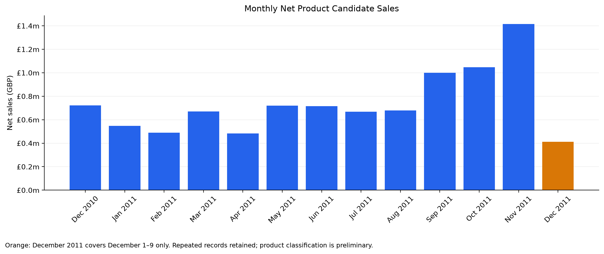
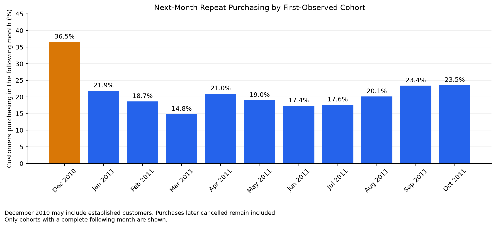
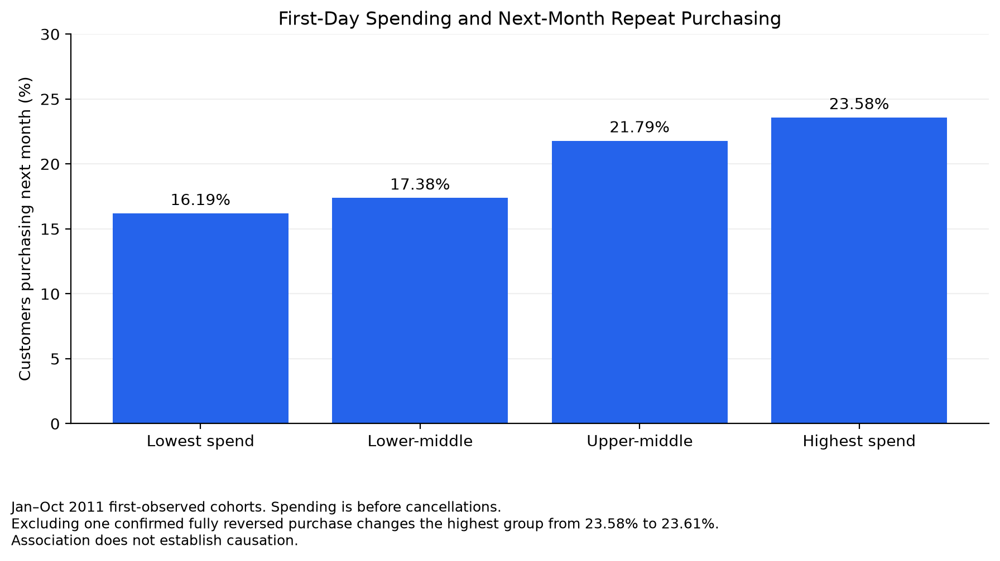

# Online Retail: Sales and Repeat Purchasing

An analysis of retail sales, cancellations, and customer purchasing patterns using **Excel, SQLite, Python, and Tableau**.

[View the interactive Tableau dashboard](https://public.tableau.com/app/profile/reshma.dangol/viz/Book1Retail_Portfolio_twbx/RetailOverview)

## Business questions

- How do net sales vary by month, country, and product?
- How do cancellations affect sales and bestseller rankings?
- Is first-day spending associated with purchasing again the following month?

## Data and approach

The UCI Online Retail dataset contains 541,909 transaction lines covering December 1, 2010–December 9, 2011.

Excel supported initial exploration and reconciliation. SQLite views made the filtering rules reusable. Python validated results and investigated customer behavior. Tableau presents monthly and international sales.

**Net product candidate sales** include positive-priced product candidate sales and signed C-prefixed cancellation lines. Identified postage, bank charges, discounts, manual entries, and bad-debt adjustments are reported separately. Unmapped stock codes remain product candidates pending further review.

## Key findings

- Net product candidate sales total **£9,567,877.37**.
- The UK contributes **84.36%** of that value.
- November 2011 recorded **£1,416,244.38**, up **35.28%** from October.
- Included product cancellation value offsets **7.04%** of positive product candidate sales.
- **2,829 of 4,334** purchasing customers had at least two qualifying purchase invoices: **65.27%**.
- Among January–October 2011 first-observed cohorts, next-month repeat purchasing rose from **16.19%** in the lowest first-day spending group to **23.58%** in the highest. After standardizing cohort composition, the rates were **16.25%** and **23.36%**.

## Validation and investigation

- Reconciled row counts, raw totals, and key sales results between Excel and SQL.
- Resolved a **£2.55 discrepancy** caused by lowercase stock code `m`. Case-normalized SQL comparisons matched Excel.
- Investigated an apparent bestseller whose **£168,469.60** sale was offset by an equal cancellation.
- Compared duplicate-handling approaches: excluding repeated normalized product rows reduced net candidate sales by **£21,380.98**, approximately **0.22%**.

## Visual analysis

### Monthly sales

December 2011 includes only December 1–9.

### Next-month repeat purchasing

Cohorts reflect first observed purchases, not necessarily new customers.

### First-day spending and repeat purchasing

The relationship is observational. Purchase activity includes
transactions that may later have been cancelled.

## Limitations

- December 2011 contains only nine days of observations.
- First observed purchases are not necessarily customers’ first-ever purchases.
- Repeat-purchase measures include purchases subsequently cancelled.
- Repeated records remain in the baseline; identical rows do not necessarily prove erroneous duplication.
- Product classification remains preliminary.
- Spending and repeat purchasing are associated; the analysis does not establish causation.

## Running the analysis

### Requirements
- Python with pandas, matplotlib, and Jupyter Notebook
- DB Browser for SQLite to import the source CSV
pip install -r requirements.txt

### Setup
1. Download or clone this repository.
2. Download the original Excel dataset from the UCI source linked below.
3. Export its original data sheet as `online_retail_raw.csv`.
   Preserve all eight column headers and all 541,909 transaction rows.
4. In DB Browser, create `retail_analysis.db` in the repository folder.
5. Import the CSV as `retail_transactions`, enabling
   "Column names in first line."
6. Confirm the columns are InvoiceNo, StockCode, Description, Quantity,
   InvoiceDate, UnitPrice, CustomerID, and Country.
7. The SQL date conversion expects month/day/two-digit-year text,
   such as `12/1/10 8:26`. Check the imported format before continuing.
8. Run `sql/01_create_views.sql` once in the new database, then save
   changes.
9. Open `Retail_Portfolio_Analysis.ipynb` from the repository folder
   and run the cells in order.

The two included summary CSVs support the initial chart sections.
Running the complete notebook also requires the SQLite database.

### Validation targets
- Source rows: 541,909
- Raw quantity × unit-price total: £9,747,747.93
- Net product candidate sales: £9,567,877.37

## Project status

The repository includes the Python notebook, SQL view definitions,
analysis charts, summary CSV exports, and setup instructions.
The Tableau sales dashboard is published and linked above.

Excel was used for initial exploration and reconciliation.
The Excel workbook is maintained locally and is not included here.

The analysis remains preliminary: product classification requires
further review, and customer activity measures include purchases
that may later have been cancelled.

## Data source

Chen, D. (2015). *Online Retail*. UCI Machine Learning Repository.  
https://doi.org/10.24432/C5BW33

Dataset license: Creative Commons Attribution 4.0 International.
